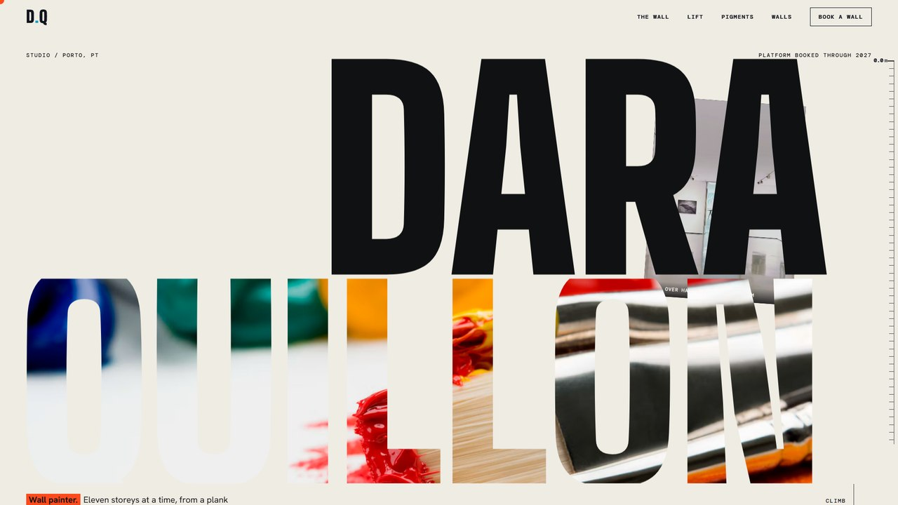
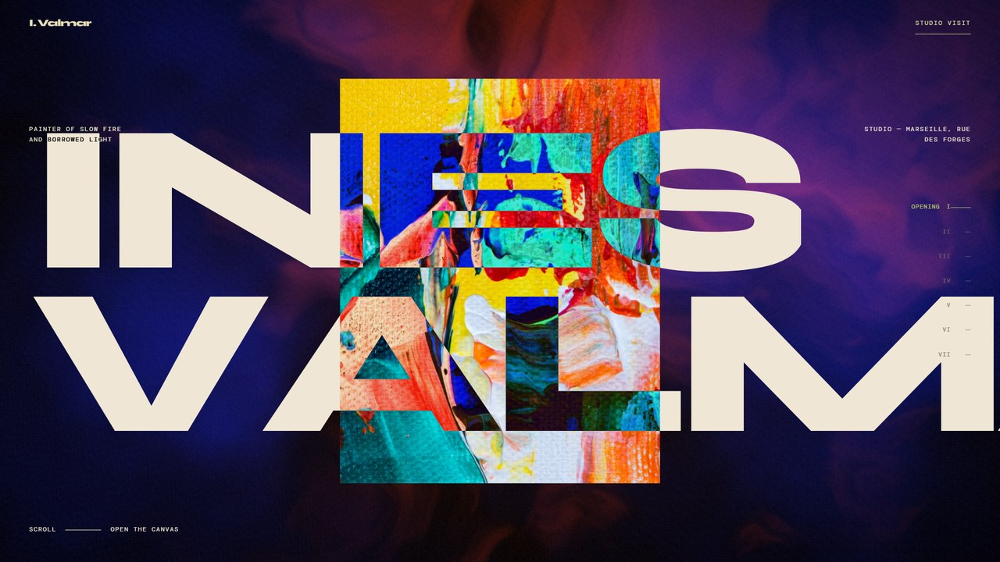
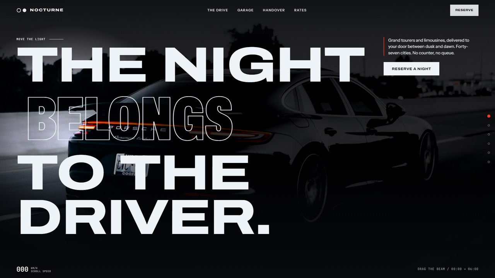
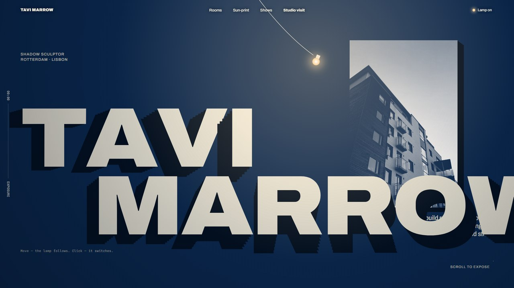
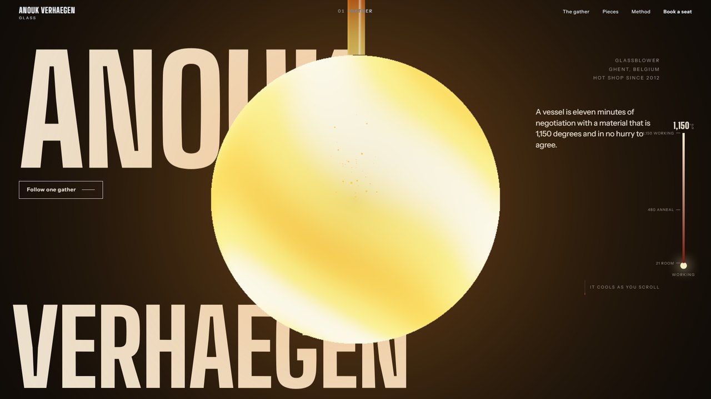
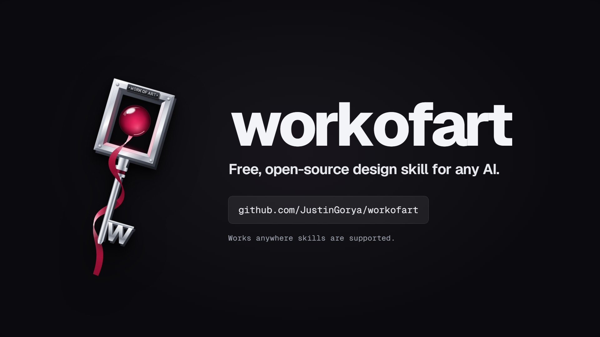

<div align="center">


# workofart

**Give your AI an eye for design.**

Design direction, frontend builds, and AI-pattern audits in one portable skill. Works anywhere Agent Skills are supported.

**[Website](https://sen.computer/workofart/)** · [Explore the cinematic tour](https://sen.computer/workofart/cinematic/)

[](https://skills.sh/JustinGorya/workofart/workofart)
[](LICENSE)

</div>

## Install

workofart is a standard Agent Skill: one folder with a `SKILL.md`, reference guides, and an optional scanner. It is not tied to one product or to coding tools. Use it in any app, agent, or API that supports skills.

**Upload it.** Download [`workofart.zip`](https://github.com/JustinGorya/workofart/releases/latest/download/workofart.zip) and add it wherever your AI lets you upload a skill. The archive holds a single `workofart/` folder.

**Install it with the skills CLI.** For tools that load skills from a folder on disk:

```bash
npx skills add JustinGorya/workofart --skill workofart
```

Choose where to install when prompted. Requires Node.js 22.20+ and npm; add `-g` for a global install. The [skills CLI](https://github.com/vercel-labs/skills) installs only [`skills/workofart/`](skills/workofart/), without this README, screenshots, or marketing files. To inspect the package first, run `npx skills add JustinGorya/workofart --list`.

**Copy it by hand.** Copy the entire `skills/workofart/` folder into any skills directory. Keep its `references/`, `scripts/`, and `LICENSE` together with `SKILL.md`.

## Use it

| Ask your AI | Mode | What you get |
|---|---|---|
| “Use workofart to design a ceramics studio website.” | **Direct** | A design contract grounded in the brief: palette, typography, layout, and motion. |
| “Build it.” | **Build** | The frontend implementation, checked for recurring AI patterns before it is handed over. |
| “Use workofart to audit this site for AI tells.” | **Audit** | Candidate patterns, source locations, and specific fixes for review. Share the files, paste the code, or name a folder. |

The default direction is ambitious and motion-rich. Ask for “calm,” “minimal,” “standard layout,” or “no animation” to adjust it.

The skill itself needs no API keys, accounts, or packages. Its bundled scanner runs wherever Python 3.10+ is available; where code can't run, your AI checks the work against the tell index instead. You can also [run the scanner yourself](#standalone-scanner).

## Website showcase

Six example websites from the launch film. Click a screenshot for the full image.

| Dara Quillon — mural painter | Ilse Varga — pigment painter |
|---|---|
| [](docs/assets/showcase/dara-quillon.jpg) | [](docs/assets/showcase/ilse-varga.jpg) |
| **Ines Valmar — expressionist painter** | **Nocturne — night-time car rentals** |
| [](docs/assets/showcase/ines-valmar.jpg) | [](docs/assets/showcase/nocturne-rentals.jpg) |
| **Tavi Marrow — shadow sculptor** | **Anouk Verhaegen — glassblower** |
| [](docs/assets/showcase/tavi-marrow.jpg) | [](docs/assets/showcase/anouk-verhaegen.jpg) |

[](https://github.com/JustinGorya/workofart/releases/download/v1.0.0/workofart-launch-60fps.mp4)

[Watch the launch film](https://github.com/JustinGorya/workofart/releases/download/v1.0.0/workofart-launch-60fps.mp4) · [Campaign images and production source](https://github.com/JustinGorya/workofart/releases/tag/v1.0.0)

## How it works

AI-generated sites often share a layout even when their colors and fonts differ. workofart derives the design from the actual brief, then checks the implementation against **85 documented tells across 17 structural slots**. A match is a prompt for inspection, not an automatic failure or a banned pattern.

Three calibration levers control **creativity**, **layout structure**, and **immersivity**. Each score and design choice must point to a concrete detail in the brief.

Read the [design and audit guide](docs/guide.md), [skill instructions](skills/workofart/SKILL.md), or [tell index](skills/workofart/references/tells.md).

## Standalone scanner

From a clone of this repository:

```bash
python skills/workofart/scripts/scan.py path/to/site
python skills/workofart/scripts/scan.py path/to/site --all
python skills/workofart/scripts/scan.py path/to/site --json
```

The scanner uses Python's standard library, prints `file:line` findings, and does not modify the files it scans. See [the guide](docs/guide.md#standalone-scanner) for supported formats and options.

## Repository layout

```text
skills/workofart/      installable skill; self-contained instructions and scanner
  SKILL.md             entrypoint and discovery metadata
  LICENSE              MIT terms included in the installed package
  references/          design guidance and tell index
  scripts/scan.py      zero-dependency scanner
docs/                  extended guide and README images
tools/                 package validation
tests/                 scanner and packaging checks
.github/workflows/     automated validation and install smoke test
```

Each [release](https://github.com/JustinGorya/workofart/releases/latest) attaches `workofart.zip`, the installable skill. The launch film, campaign images, and production source are separate release downloads; they are not part of the source tree or the installed skill.

## Contributing

See [CONTRIBUTING.md](CONTRIBUTING.md) for local checks and guidance on adding a tell. Issues and pull requests are welcome.

## License

[MIT](LICENSE) © 2026 JustinGorya
